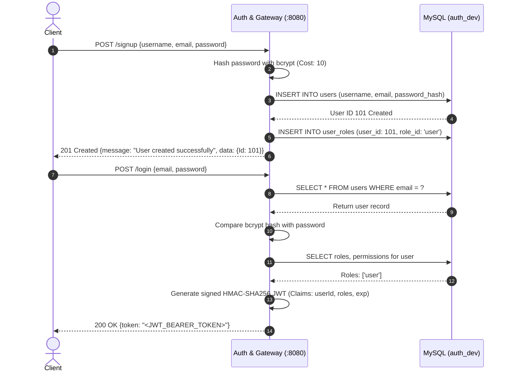
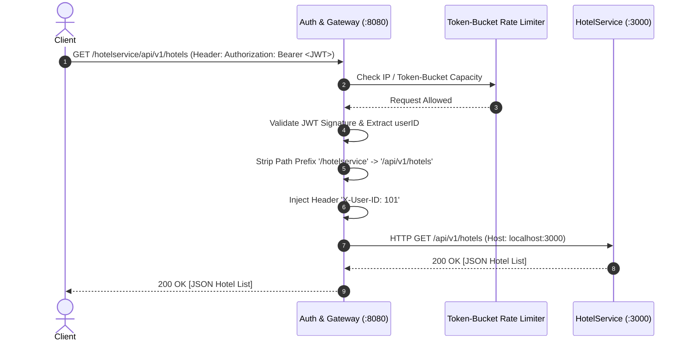
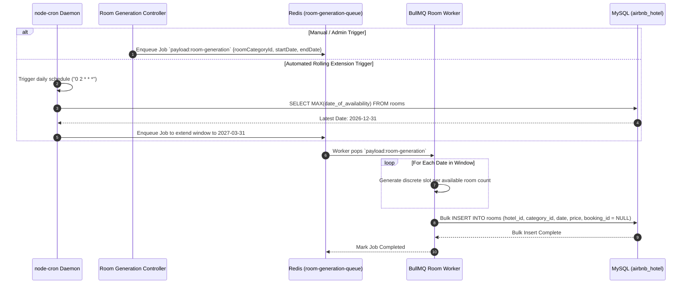
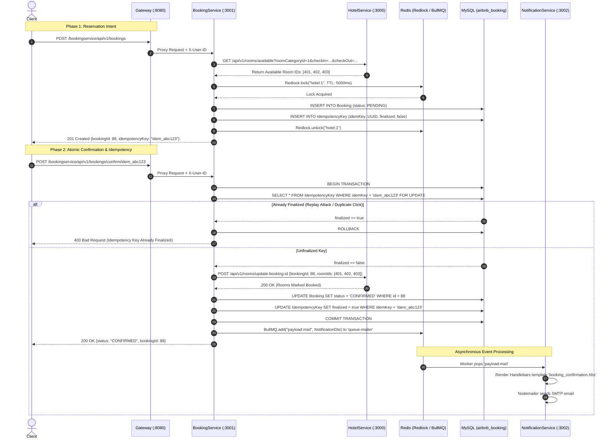

# Airbnb Microservices Platform - Architecture Overview

This document provides a visual and operational walkthrough of every architectural component in the platform, detail on how services communicate, and tracing of end-to-end data lifecycles.

---

## 1. System Topology & Component Graph

```
+==================================================================================================+
|                                    CLIENTS & EXTERNAL CONSUMERS                                   |
|                                                                                                  |
|         +-----------------------+                    +---------------------------------+         |
|         | Web / Mobile Client   |                    | Automated Postman Test Suite    |         |
|         +-----------+-----------+                    +----------------+----------------+         |
+=====================|=================================================|==========================+
                      |                                                 |
                      +-----------------------+-------------------------+
                                              |
                                              | HTTP Requests
                                              v
+==================================================================================================+
|                          EDGE REVERSE PROXY & AUTH GATEWAY (AuthInGo :8080)                      |
|                                                                                                  |
|   +------------------------------------------------------------------------------------------+   |
|   | Chi HTTP Router & Middleware Pipeline                                                    |   |
|   |  - Token Bucket Rate Limiter (golang.org/x/time/rate)                                    |   |
|   |  - JWT Authentication Middleware (golang-jwt/jwt/v5)                                     |   |
|   |  - RBAC Role Guard Middleware (RequireAnyRole, RequireAllRoles)                          |   |
|   +------------------------------------------------------------------------------------------+   |
|       |                                 |                                 |                      |
|       v                                 v                                 v                      |
|   +---------------+             +-----------------+             +------------------+             |
|   | Auth Handlers |             | Proxy Director  |             | OTP Controller   |             |
|   | /signup       |             | Strips prefixes |             | /api/otp/send    |             |
|   | /login        |             | Injects headers |             | /api/otp/verify  |             |
|   | /roles        |             | (X-User-ID)     |             +--------+---------+             |
|   +-------+-------+             +--------+--------+                      |                       |
+===========|==============================|===============================|=======================+
            |                              |                               |
            v SQL (Goose)                  |                               v HTTP POST /send
      +-----------+                        |                       +-------------------------------+
      | MySQL     |                        |                       | NotificationService (:3002)   |
      | auth_dev  |                        |                       +-------------------------------+
      +-----------+                        |
                                           +-------------------------------+
                                           |                               |
                                           v HTTP /hotelservice/*          v HTTP /bookingservice/*
+======================================================+ +=========================================+
| HOTEL SERVICE (:3000)                                | | BOOKING SERVICE (:3001)                 |
|                                                      | |                                         |
|  +--------------------+    +----------------------+  | |  +-------------------+  +-------------+ |
|  | Hotels Controller  |    | Rooms Controller     |  | |  | Booking Controller|  | Hotel REST  | |
|  | /api/v1/hotels     |    | /rooms/available     |  | |  | /api/v1/bookings  |  | API Client  | |
|  +--------------------+    +----------+-----------+  | |  +---------+---------+  | (Axios)     | |
|                                       ^              | |            |            +------+------+ |
|                                       |              | |            v                   |        |
|  +--------------------+    +----------+-----------+  | |  +-------------------+         |        |
|  | Room Gen Processor |    | BaseRepository<T>    |  | |  | Booking Service   |<--------+        |
|  | (BullMQ Worker)    |    | (Sequelize ORM)      |  | |  | Redlock Mutex     |                  |
|  +---------+----------+    +----------+-----------+  | |  | 2-Phase Engine    |                  |
|            |                          |              | |  +---------+---------+                  |
|  +---------+----------+               |              | |            |                            |
|  | node-cron Daemon   |               |              | |  +---------+---------+                  |
|  | Rolling Extension  |               |              | |  | Prisma Client     |                  |
|  +--------------------+               |              | |  | (ACID + Row Locks)|                  |
+=======================================|==============+ +============|============================+
                                        |                             |
                                        v SQL                         v SQL
                                 +--------------+              +---------------+
                                 | MySQL        |              | MySQL         |
                                 | airbnb_hotel |              | airbnb_booking|
                                 +--------------+              +---------------+
                                        ^                             ^
                                        |                             |
                                        | Redis Connections           |
                                        v                             v
+==================================================================================================+
|                                    REDIS 7.0+ INFRASTRUCTURE (:6379)                             |
|                                                                                                  |
|   +-----------------------+    +---------------------------+    +----------------------------+   |
|   | Redlock Distributed   |    | BullMQ Job Queue:         |    | BullMQ Job Queue:          |   |
|   | Mutex: `hotel:{id}`   |    | `room-generation-queue`   |    | `queue-mailer`             |   |
|   +-----------------------+    +---------------------------+    +-------------+--------------+   |
+===============================================================================|==================+
                                                                                |
                                                                                | Pops Job `payload:mail`
                                                                                v
+==================================================================================================+
|                              NOTIFICATION SERVICE (:3002)                                        |
|                                                                                                  |
|   +------------------------------------------------------------------------------------------+   |
|   | setupMailerWorker() (BullMQ Worker)                                                      |   |
|   +------------------------------------------------------------------------------------------+   |
|       |                                                                                          |
|       v                                                                                          |
|   +---------------------------+    +--------------------------+    +-------------------------+   |
|   | Handlebars Template Engine|    | Dynamic Email Templates  |    | Nodemailer SMTP         |   |
|   | (templates.handler.ts)    |--->| - booking_confirmation   |--->| Transport               |   |
|   | Compiles context data     |    | - welcome, otp, reset    |    | (mailer.service.ts)     |   |
|   +---------------------------+    +--------------------------+    +------------+------------+   |
+=================================================================================|================+
                                                                                  |
                                                                                  | Delivers Email
                                                                                  v
                                                                        +------------------+
                                                                        | SMTP Mail Server |
                                                                        +------------------+
```

---

## 2. Request Flow Diagrams

### 2.1 User Registration & JWT Authentication Flow



---

### 2.2 Reverse Proxy Gateway Routing Flow



---

### 2.3 Room Inventory Pre-Materialization & Automated Cron Flow



---

### 2.4 Distributed Two-Phase Booking Confirmation Flow



---

## 3. Module & Service Dependency Graph

```
project1
  ├── AuthInGo (:8080)
  │     ├── chi router (routing & reverse proxy)
  │     ├── Goose (MySQL migrations for auth_dev)
  │     ├── rate limiter (token bucket)
  │     └── notification_client (HTTP calling NotificationService:3002)
  │
  ├── HotelService (:3000)
  │     ├── Express 5 router (/hotels, /rooms, /room-generation, /scheduler)
  │     ├── Sequelize ORM (MySQL models: Hotel, Room, RoomCategory)
  │     ├── BullMQ ('room-generation-queue' producer & worker)
  │     ├── node-cron ('roomScheduler.ts' automated availability extension)
  │     └── Jest / Supertest (tests/controllers/)
  │
  ├── BookingService (:3001)
  │     ├── Express 5 router (/bookings)
  │     ├── Prisma ORM (MySQL models: Booking, IdempotencyKey)
  │     ├── Redlock algorithm (ioredis mutex on 'hotel:{id}')
  │     ├── hotel.api.ts (Axios REST client calling HotelService:3000)
  │     └── email.producer.ts (BullMQ producer pushing to 'queue-mailer')
  │
  └── NotificationService (:3002)
        ├── Express 5 router (/notifications)
        ├── BullMQ ('queue-mailer' worker)
        ├── Handlebars (templates/mailer/*.hbs)
        └── Nodemailer (SMTP transport)
```

---

## 4. Background Services & Cron Daemons

| Worker / Daemon | Process Host | Trigger Interval / Queue | Purpose & Responsibilities |
| :--- | :--- | :--- | :--- |
| **`setupMailerWorker`** | `NotificationService` | Continuous (`queue-mailer`) | Consumes booking confirmation and welcome email events from Redis, compiles Handlebars templates, and transmits SMTP mail. |
| **`setupRoomGenerationWorker`** | `HotelService` | On-Demand (`room-generation-queue`) | Pulls batch room generation jobs, performs calendar iteration, and executes bulk database insertions for daily room inventory. |
| **`startScheduler`** | `HotelService` | Cron Expression (`ROOM_CRON`: `"0 2 * * *"`) | Inspects current date horizon in MySQL, identifies approaching availability cutoffs, and dispatches future extension jobs automatically. |

---

## 5. Data Lifecycle & State Transition Matrix

### Booking Entity Lifecycle:
```
[Client Request] ──> PENDING ──> [Two-Phase Confirmation] ──> CONFIRMED ──> [BullMQ Event Emitted]
                        │
                        └──> CANCELLED (Timeout / User Abort)
```

| Current Status | Event / Trigger | Target Status | Side Effects & Actions |
| :--- | :--- | :--- | :--- |
| `None` | `POST /bookings` | `PENDING` | Redlock acquired, unfinalized idempotency key generated in database. |
| `PENDING` | `POST /bookings/confirm/:key` | `CONFIRMED` | Row lock verified, rooms assigned in HotelService, idempotency key finalized, BullMQ email queued. |
| `CONFIRMED` | Re-submission of same `:key` | `CONFIRMED` | Request rejected with HTTP 400 Bad Request; database state unchanged. |
| `PENDING` | Cancellation / Failure | `CANCELLED` | Lock released, room slots remain unassociated. |
