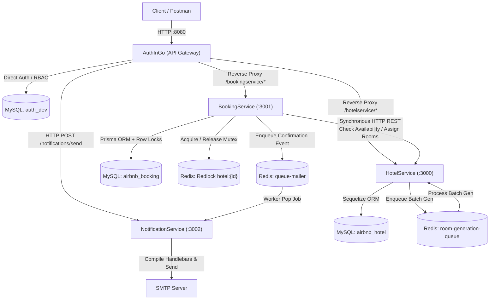

# Airbnb Distributed Microservices Platform

## Design Specification

**Date:** 2026-11-20  
**Status:** Approved (v1.0.0)  
**Architecture:** Polyglot Distributed Microservices  
**Author:** yashuu2008  

---

## 1. Project Overview

The **Airbnb Microservices Platform** is a polyglot, distributed hospitality reservation platform engineered to address the core challenges of modern online travel agencies (OTAs): extreme booking concurrency, high-performance inventory lookups without computational bottlenecks, and resilient, decoupled asynchronous transaction notifications.

In conventional monolithic reservation platforms, concurrent checkout attempts on the same hotel room often cause race conditions, double-bookings, and database transaction deadlocks. Furthermore, inventory availability lookups typically rely on complex SQL date-range interval overlap queries (`WHERE check_in < ? AND check_out > ?`), which degrade severely as database volume scales.

This platform resolves these fundamental bottlenecks through four purpose-built microservices:
1. **Edge Gateway & Identity Authority (`AuthInGo`)**: Centralized Go-based HTTP reverse proxy with path stripping, user context propagation (`X-User-ID`), token-bucket rate limiting, and normalized Role-Based Access Control (RBAC).
2. **Hospitality & Dynamic Inventory Engine (`HotelService`)**: Express 5 and Sequelize microservice featuring pre-materialized daily date-slotting inventory (converting range overlap calculations into simple indexed queries), asynchronous BullMQ batch room generation, and an autonomous rolling availability cron daemon.
3. **Reservation & Concurrency Engine (`BookingService`)**: Express 5 and Prisma microservice managing the reservation state machine using the distributed Redis Redlock algorithm (`hotel:{hotelId}`) and a Stripe-style two-phase idempotency engine backed by MySQL pessimistic row-level locking (`SELECT ... FOR UPDATE`).
4. **Asynchronous Notification Engine (`NotificationService`)**: Decoupled BullMQ worker service compiling parameterized Handlebars (`.hbs`) email templates and delivering transactional emails via Nodemailer SMTP transports.

### Core Architectural Objectives

- **Concurrency & Zero Double-Booking:** Strict distributed mutual exclusion using Redis Redlock and database row-level locking guarantees that two concurrent requests for the same room category never result in double allocation.
- **Fast Inventory Retrieval:** Discrete daily date-slotting inventory eliminates computationally heavy interval overlap logic, ensuring $O(\log N)$ B-tree index lookups.
- **Strict Idempotency:** Network retries, accidental double-clicks, and client replay attacks are neutralized via transactional idempotency keys.
- **Polyglot Service Boundary:** High-throughput edge routing and cryptography implemented in Go; dynamic ORM operations, event queues, and template compilation implemented in TypeScript / Express 5.
- **Fault-Tolerant Async Messaging:** Heavy date generation and third-party SMTP calls are offloaded to Redis BullMQ worker queues, preserving HTTP thread pool responsiveness.

---

## 2. Technology Stack

| Architectural Layer | Technology | Version | Purpose |
| :--- | :--- | :--- | :--- |
| **API Gateway & Auth Runtime** | Go | 1.24.1 | High-throughput edge routing, cryptography, and RBAC authority |
| **Gateway Routing** | `go-chi/chi` | v5.2.2 | Lightweight, idiomatic HTTP router and middleware pipeline |
| **Microservices Backend Runtime** | Node.js / TypeScript | Node 20+, TS 5.8 | Runtime for Hotel, Booking, and Notification services |
| **HTTP Framework** | Express.js | 5.1.0 | Core HTTP web framework across Node.js services |
| **Relational ORM (Booking)** | Prisma Client | 6.8.2 | Type-safe query engine and ACID transaction manager |
| **Relational ORM (Hotel)** | Sequelize | 6.37.7 | Relational persistence, migrations, and model hooks |
| **Distributed Mutex** | Redlock | 5.0.0-beta.2 | Multi-instance distributed locking algorithm |
| **Task Queue & Workers** | BullMQ | 5.53 / 5.56 | Redis-backed asynchronous message queues and background workers |
| **Cache & Queue Broker** | Redis / `ioredis` | Redis 7+, ioredis 5 | Distributed locks, message queue state, and session coordination |
| **Relational Database** | MySQL | 8.0+ | Isolated storage per microservice (`auth_dev`, `airbnb_hotel`, `airbnb_booking`) |
| **Task Scheduling** | `node-cron` | 4.2.1 | Cron daemon for automated inventory extension |
| **Email Templating Engine** | Handlebars | 4.7.8 | Compilation of dynamic HTML/text email templates (`.hbs`) |
| **Mail Transport Client** | Nodemailer | 7.0.3 | SMTP client for transactional email delivery |
| **Payload Validation** | Zod / `validator/v10` | Zod 3.24, Go v10 | Strict runtime request and DTO payload schema validation |
| **Logging & Correlation** | Winston | 3.17.0 | Structured JSON logging with Node.js `AsyncLocalStorage` tracing |
| **Automated Testing** | Jest & Supertest | Jest 29.7, Supertest 7.1 | Unit and integration testing suite for HotelService |

---

## 3. Project Structure

```
project1/
├── AuthInGo/                       # Go 1.24 Identity Service & Edge Reverse Proxy Gateway
│   ├── app/                        # Server bootstrapping and dependency wiring
│   ├── clients/                    # HTTP client calling NotificationService (/notifications/send)
│   ├── config/                     # Environment loader and MySQL connection pool
│   ├── controllers/                # HTTP handlers (auth, roles, OTP, ping)
│   ├── db/
│   │   ├── migrations/             # Goose SQL migration scripts
│   │   └── repositories/           # Raw SQL repositories (users, roles, permissions, OTPs)
│   ├── dto/                        # Request and response data transfer objects
│   ├── middlewares/                # JWT verification, RBAC role guards, rate limiting
│   ├── models/                     # Relational domain entity structs
│   ├── router/                     # Chi router declarations and reverse proxy endpoints
│   ├── utils/                      # Reverse proxy director, JWT signer, bcrypt hasher
│   ├── Makefile                    # Migration and build targets
│   └── main.go                     # Auth service entry point (Port :8080)
│
├── HotelService/                   # Express 5 Hospitality Inventory & Scheduling Engine
│   ├── src/
│   │   ├── config/                 # Sequelize, Redis, logger, and server configs
│   │   ├── controllers/            # Handlers for hotels, rooms, room generation, and scheduler
│   │   ├── db/
│   │   │   ├── migrations/         # Sequelize migration scripts
│   │   │   ├── models/             # Sequelize models (Hotel, Room, RoomCategory)
│   │   │   └── seeders/            # Database seed data
│   │   ├── dto/                    # Zod-derived DTO types
│   │   ├── middlewares/            # Correlation ID tracing and error handling
│   │   ├── processors/             # BullMQ worker for batch room slot generation
│   │   ├── producers/              # BullMQ queue producer for room generation
│   │   ├── queues/                 # BullMQ queue definition ('room-generation-queue')
│   │   ├── repositories/           # Generic BaseRepository pattern implementations
│   │   ├── routers/                # Express v1 routers (/hotels, /rooms, /room-generation, /scheduler)
│   │   ├── scheduler/              # node-cron worker for rolling inventory extension
│   │   ├── services/               # Core business logic
│   │   └── server.ts               # Service bootstrap and startup (Port :3000)
│   └── tests/                      # Jest & Supertest integration test suite
│
├── BookingService/                 # Express 5 Reservation & Concurrency Service
│   ├── src/
│   │   ├── api/                    # Axios REST client communicating with HotelService
│   │   ├── config/                 # Redis, logger, and server configurations
│   │   ├── controllers/            # Handlers for booking creation, confirmation, and lookup
│   │   ├── dto/                    # Booking and notification DTOs
│   │   ├── middlewares/            # Correlation ID tracing and global error handler
│   │   ├── prisma/
│   │   │   ├── migrations/         # Prisma migration history
│   │   │   └── schema.prisma       # Prisma schema (Booking, IdempotencyKey)
│   │   ├── producers/              # BullMQ producer dispatching to 'queue-mailer'
│   │   ├── queues/                 # BullMQ queue definition ('queue-mailer')
│   │   ├── repositories/           # Database queries with Prisma transactions & row locks
│   │   ├── routers/                # Express v1 router (/bookings)
│   │   ├── services/               # Redlock mutex and two-phase idempotency logic
│   │   └── server.ts               # Service bootstrap and startup (Port :3001)
│
├── NotificationService/            # Express 5 Asynchronous Email Worker Service
│   ├── src/
│   │   ├── config/                 # Nodemailer transport, Redis, and logger configs
│   │   ├── controllers/            # Direct notification endpoint handler
│   │   ├── dto/                    # Notification payload DTOs
│   │   ├── middlewares/            # Correlation tracing and error handling
│   │   ├── processors/             # BullMQ email worker processor
│   │   ├── producers/              # Internal BullMQ email queue producer
│   │   ├── queues/                 # BullMQ queue definition ('queue-mailer')
│   │   ├── routers/                # Express v1 router (/notifications)
│   │   ├── services/               # Nodemailer email dispatch service
│   │   ├── templates/              # Handlebars email templates (.hbs) and renderer
│   │   └── server.ts               # Worker bootstrap and Express server (Port :3002)
│
├── postman/                        # Complete integration test suite & environments
│   ├── Airbnb_Microservices.postman_collection.json
│   └── Airbnb_Microservices.postman_environment.json
│
└── docs/                           # Architecture, HLD, LLD & Design documentation
    ├── design.md                   # This file
    ├── HLD.md                      # High Level Design
    ├── architecture.md             # Visual Architecture & Request Flows
    └── LLD.md                      # Low Level Design & Code Internals
```

---

## 4. Database Schemas

Each microservice strictly controls its own relational database instance. Inter-service database sharing is forbidden; all cross-boundary interactions occur via synchronous REST APIs or asynchronous BullMQ message queues.

### 4.1 Database: `auth_dev` (Owned by `AuthInGo`)
Managed via Goose SQL migrations. Implements a normalized, multi-tier Role-Based Access Control (RBAC) hierarchy.

```sql
-- Users table
CREATE TABLE users (
    id BIGINT AUTO_INCREMENT PRIMARY KEY,
    username VARCHAR(50) NOT NULL UNIQUE,
    email VARCHAR(100) NOT NULL UNIQUE,
    password_hash VARCHAR(255) NOT NULL,
    is_verified BOOLEAN DEFAULT FALSE,
    created_at TIMESTAMP DEFAULT CURRENT_TIMESTAMP,
    updated_at TIMESTAMP DEFAULT CURRENT_TIMESTAMP ON UPDATE CURRENT_TIMESTAMP
);

-- Roles table
CREATE TABLE roles (
    id BIGINT AUTO_INCREMENT PRIMARY KEY,
    name VARCHAR(50) NOT NULL UNIQUE,
    description VARCHAR(200) NOT NULL,
    created_at TIMESTAMP DEFAULT CURRENT_TIMESTAMP
);

-- Permissions table
CREATE TABLE permissions (
    id BIGINT AUTO_INCREMENT PRIMARY KEY,
    name VARCHAR(100) NOT NULL UNIQUE,
    description VARCHAR(255) NOT NULL,
    created_at TIMESTAMP DEFAULT CURRENT_TIMESTAMP
);

-- Many-to-Many mapping: Role -> Permissions
CREATE TABLE role_permissions (
    role_id BIGINT NOT NULL,
    permission_id BIGINT NOT NULL,
    PRIMARY KEY (role_id, permission_id),
    FOREIGN KEY (role_id) REFERENCES roles(id) ON DELETE CASCADE,
    FOREIGN KEY (permission_id) REFERENCES permissions(id) ON DELETE CASCADE
);

-- Many-to-Many mapping: User -> Roles
CREATE TABLE user_roles (
    user_id BIGINT NOT NULL,
    role_id BIGINT NOT NULL,
    PRIMARY KEY (user_id, role_id),
    FOREIGN KEY (user_id) REFERENCES users(id) ON DELETE CASCADE,
    FOREIGN KEY (role_id) REFERENCES roles(id) ON DELETE CASCADE
);

-- OTP verification tokens
CREATE TABLE otps (
    id BIGINT AUTO_INCREMENT PRIMARY KEY,
    email VARCHAR(100) NOT NULL,
    code VARCHAR(6) NOT NULL,
    purpose ENUM('email_verification', 'password_reset') NOT NULL,
    is_used BOOLEAN DEFAULT FALSE,
    expires_at TIMESTAMP NOT NULL,
    created_at TIMESTAMP DEFAULT CURRENT_TIMESTAMP,
    INDEX idx_email_purpose (email, purpose)
);
```

### 4.2 Database: `airbnb_hotel` (Owned by `HotelService`)
Managed via Sequelize ORM migrations. Implements discrete daily date-slotting inventory.

```sql
-- Hotels catalog
CREATE TABLE hotels (
    id INT AUTO_INCREMENT PRIMARY KEY,
    name VARCHAR(255) NOT NULL,
    address VARCHAR(255) NOT NULL,
    location VARCHAR(255) NOT NULL,
    rating FLOAT DEFAULT NULL,
    rating_count INT DEFAULT NULL,
    created_at TIMESTAMP DEFAULT CURRENT_TIMESTAMP,
    updated_at TIMESTAMP DEFAULT CURRENT_TIMESTAMP ON UPDATE CURRENT_TIMESTAMP,
    deleted_at TIMESTAMP NULL DEFAULT NULL
);

-- Room categories / classifications
CREATE TABLE room_categories (
    id INT AUTO_INCREMENT PRIMARY KEY,
    hotel_id INT NOT NULL,
    price INT NOT NULL,
    room_type ENUM('SINGLE', 'DOUBLE', 'FAMILY', 'DELUXE', 'SUITE') NOT NULL,
    room_count INT NOT NULL,
    created_at TIMESTAMP DEFAULT CURRENT_TIMESTAMP,
    updated_at TIMESTAMP DEFAULT CURRENT_TIMESTAMP ON UPDATE CURRENT_TIMESTAMP,
    deleted_at TIMESTAMP NULL DEFAULT NULL,
    FOREIGN KEY (hotel_id) REFERENCES hotels(id) ON DELETE CASCADE
);

-- Materialized daily room inventory slots
CREATE TABLE rooms (
    id INT AUTO_INCREMENT PRIMARY KEY,
    hotel_id INT NOT NULL,
    room_category_id INT NOT NULL,
    date_of_availability DATE NOT NULL,
    price INT NOT NULL,
    booking_id INT DEFAULT NULL,
    created_at TIMESTAMP DEFAULT CURRENT_TIMESTAMP,
    updated_at TIMESTAMP DEFAULT CURRENT_TIMESTAMP ON UPDATE CURRENT_TIMESTAMP,
    deleted_at TIMESTAMP NULL DEFAULT NULL,
    FOREIGN KEY (hotel_id) REFERENCES hotels(id) ON DELETE CASCADE,
    FOREIGN KEY (room_category_id) REFERENCES room_categories(id) ON DELETE CASCADE,
    INDEX idx_avail_search (room_category_id, date_of_availability, booking_id)
);
```

### 4.3 Database: `airbnb_booking` (Owned by `BookingService`)
Managed via Prisma ORM schema migrations. Implements reservation state machines and two-phase idempotency.

```prisma
model Booking {
  id                Int             @id @default(autoincrement())
  userId            Int
  hotelId           Int
  roomCategoryId    Int
  checkInDate       DateTime
  checkOutDate      DateTime
  bookingAmount     Int
  totalGuests       Int
  status            BookingStatus   @default(PENDING)
  createdAt         DateTime        @default(now())
  updatedAt         DateTime        @updatedAt
  idempotencyKey    IdempotencyKey?
}

model IdempotencyKey {
  id         Int      @id @default(autoincrement())
  idemKey    String   @unique
  finalized  Boolean  @default(false)
  bookingId  Int      @unique
  booking    Booking? @relation(fields: [bookingId], references: [id])
  createdAt  DateTime @default(now())
  updatedAt  DateTime @updatedAt
}

enum BookingStatus {
  PENDING
  CONFIRMED
  CANCELLED
}
```

---

## 5. Architectural Components & Subsystems

### 5.1 Edge Reverse Proxy Gateway (`AuthInGo`)
- Built using Go's `net/http/httputil.NewSingleHostReverseProxy`.
- Serves as the single public entry point for downstream microservices:
  - Route `/hotelservice/*` $\rightarrow$ forwards to `HOTEL_SERVICE_URL` (Port 3000), stripping `/hotelservice`.
  - Route `/bookingservice/*` $\rightarrow$ forwards to `BOOKING_SERVICE_URL` (Port 3001), stripping `/bookingservice`.
- Dynamic Director: Inspects request context for authenticated JWT claims; injects `X-User-ID: <userId>` header into proxied requests.
- Rate Limiting: Embedded token-bucket rate limiter (`golang.org/x/time/rate`) preventing upstream overload.

### 5.2 Pre-Materialized Inventory & Cron Subsystem (`HotelService`)
- Traditional range-based availability lookups require expensive intersection queries across historical bookings.
- The Date-Slotting engine pre-materializes discrete daily inventory records in the `rooms` table.
- A stay from `2026-12-01` to `2026-12-04` requires 3 consecutive daily records (`2026-12-01`, `2026-12-02`, `2026-12-03`) with `booking_id IS NULL`.
- Heavy multi-month generation is dispatched to BullMQ queue `room-generation-queue` and handled asynchronously by `setupRoomGenerationWorker`.
- `node-cron` daemon continuously evaluates current calendar dates against existing inventory horizons and automatically dispatches extension batches (`roomScheduler.ts`).

### 5.3 Distributed Concurrency & Idempotency Engine (`BookingService`)
- **Phase 1: Reservation Intent (`POST /api/v1/bookings`)**
  1. Validates stay parameters via Zod schema.
  2. Queries `HotelService: GET /api/v1/rooms/available` via Axios to obtain unbooked room IDs.
  3. Acquires a distributed mutex using Redis Redlock on resource key `hotel:{hotelId}` with a 5000ms TTL.
  4. Inserts a new `Booking` record with status `PENDING`.
  5. Generates a unique UUID v4 idempotency key and inserts an unfinalized record (`finalized: false`) in `IdempotencyKey`.
  6. Releases the Redlock distributed mutex.
  7. Returns HTTP 201 with `bookingId` and `idempotencyKey`.
- **Phase 2: Idempotent Confirmation (`POST /api/v1/bookings/confirm/:idempotencyKey`)**
  1. Opens an ACID transaction via Prisma.
  2. Executes pessimistic row-level locking: `SELECT * FROM IdempotencyKey WHERE idemKey = ? FOR UPDATE`.
  3. If `finalized == true`, immediately rejects request with HTTP 400 (Idempotency Key already processed).
  4. If `finalized == false`, invokes `HotelService: POST /api/v1/rooms/update-booking-id` to associate room records with `bookingId`.
  5. Updates `Booking` status to `CONFIRMED`.
  6. Sets `IdempotencyKey.finalized = true`.
  7. Commits transaction.
  8. Enqueues event job `payload:mail` to Redis BullMQ `queue-mailer`.
  9. Returns HTTP 200 with confirmed reservation payload.

### 5.4 Asynchronous Notification Subsystem (`NotificationService`)
- Decoupled from the primary HTTP reservation response cycle.
- Background worker `setupMailerWorker` subscribes to Redis BullMQ queue `queue-mailer`.
- Reads job payload `NotificationDto` (`to`, `subject`, `templateId`, `params`).
- Compiles the corresponding Handlebars template (`booking_confirmation.hbs`, `welcome.hbs`, `email_verification_otp.hbs`).
- Dispatches transactional email via Nodemailer SMTP transport.
- Automatic exponential backoff and retry policies protect upstream services from third-party SMTP latency.

---

## 6. Inter-Service Communication Topology



---

## 7. Deployment & Operational Topology

### Port Allocation:
- **`AuthInGo` & API Gateway:** `8080`
- **`HotelService`:** `3000`
- **`BookingService`:** `3001`
- **`NotificationService`:** `3002`
- **MySQL Server:** `3306` (Logical databases: `auth_dev`, `airbnb_hotel`, `airbnb_booking`)
- **Redis Server:** `6379` (DB 0: Redlock mutexes, BullMQ queues)

### Startup Sequence:
1. Start MySQL 8.0 and Redis 7.0 instances.
2. Initialize logical databases: `auth_dev`, `airbnb_hotel`, `airbnb_booking`.
3. Run migrations across services:
   - `AuthInGo`: `make migrate-up` (Goose)
   - `HotelService`: `npm run migrate` (Sequelize CLI)
   - `BookingService`: `npx prisma migrate dev` (Prisma Migrate)
4. Launch background worker service: `NotificationService` (`npm run dev`).
5. Launch hospitality engine: `HotelService` (`npm run dev`).
6. Launch reservation engine: `BookingService` (`npm run dev`).
7. Launch API Gateway: `AuthInGo` (`go run main.go`).

---

## 8. Out of Scope (Current Architecture)

- Distributed tracing collectors (OpenTelemetry / Jaeger collector backend).
- Multi-region database replication and active-active Redis clustering.
- Payment gateway integration (Stripe / PayPal direct webhooks).
- Kubernetes Helm charts and service mesh (Istio / Linkerd).
